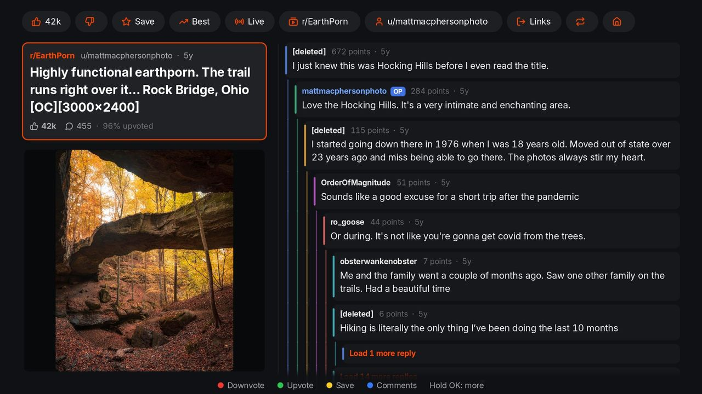
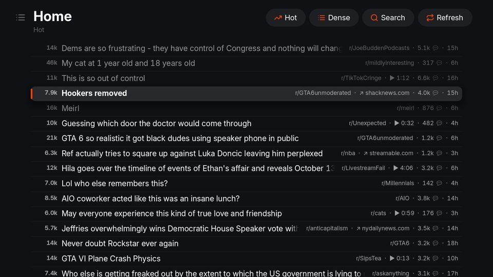
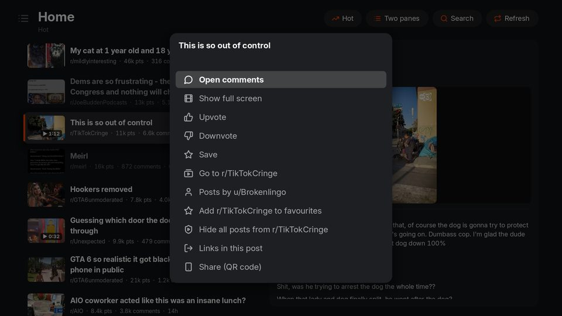
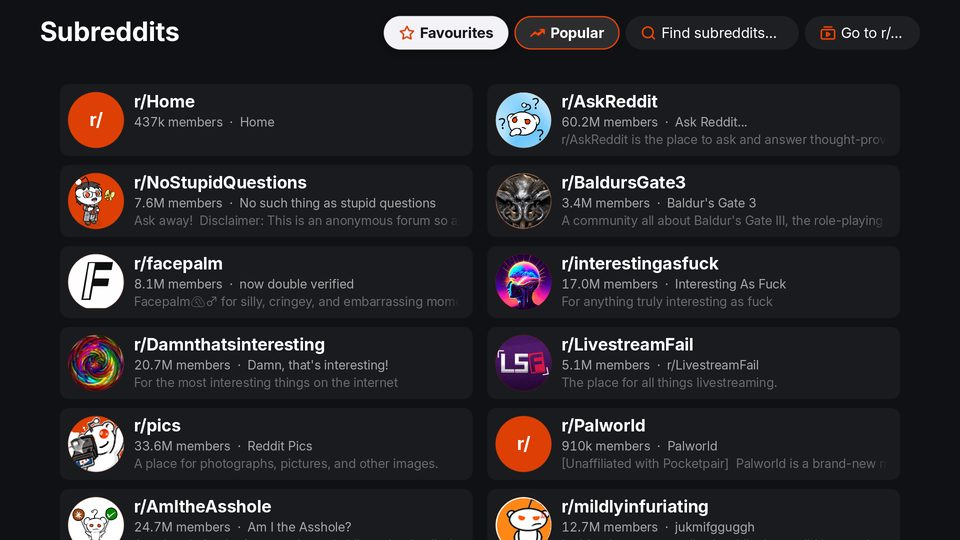

# rdtnative

> [!IMPORTANT]
> **Bring your own API key.** rdtnative comes without a Reddit API key: it only works with a
> client ID you supply yourself (entered in Settings › Reddit API, with the remote or from your
> phone). There are ways to get a working API key; search Reddit for them.

A native Reddit client for LG webOS TVs (webOS 4+), built for the Magic Remote. It is a Rust app
with no browser or Android runtime, built the same way as
[ytnative](https://github.com/danzig666/ytnative): the UI core is vendored from
[plx-native](https://github.com/GLinnik21/plx-native) and draws with OpenGL ES.

The API key (client ID), redirect URI and user agent are typed with the remote, or entered on a
phone by scanning a QR code (a one-time page on the home network).

> Not affiliated with Reddit or LG. Use at your own risk.

**Status:** a full client, tested in the simulator against live Reddit; TV testing next.

| | |
|---|---|
|  |  |
|  |  |
|  |  |

These are screenshots from the Windows simulator, which runs the same UI code as the TV build.

### Features

- **Feeds:** Home, Popular, All, any subreddit, favourites (one or all together), custom feeds,
  users, saved posts, search. Sorts (Best, Hot, New, Top, Rising, Controversial) with time ranges,
  remembered per subreddit. Endless paging; each feed keeps its place, and the start page can be
  the last feed shown.
- **Subreddits and users:** a subreddit's info page (members, rules, sidebar, join) and user
  profiles (karma, cake day, posts and comments).
- **Six layouts:** Two panes (a list with a live preview of the selected post and its top
  comments; the default), Cards (2-6 per row), List, Large, Compact and Dense (one line per post).
- **Posts:** pictures, galleries with captions, v.redd.it videos and GIFs (played by the TV),
  Imgur images, albums and GIFs, YouTube (opens in ytnative or LG's YouTube app), links (QR code),
  crossposts, and Reddit markdown: headings, quotes, lists, code, tables, spoilers, superscript,
  links.
- **Comments:** threaded with coloured depth rails, collapse with OK, "load more" in place,
  "continue this thread", OP / moderator / pinned marks, flairs; Left goes to the parent, Right to
  the next thread. Links to a comment open on it. Comments new since the last visit are marked
  (CH▲ / CH▼ jump between them), and Live mode keeps match and game threads updating.
- **Full screen:** pictures with zoom and pan, galleries with thumbnails, the video player with
  speed, quality, loop, replay and the remote's media keys.
- **Lean back:** a slideshow or a video channel of any feed, and an idle screen of pictures from a
  subreddit; the TV stays awake while they play.
- **Signed in:** vote, save posts and comments, hide (with undo), join and leave subreddits,
  reply (drafts are kept), inbox with new-message alerts, your saved and submitted posts. Several
  accounts with a switcher. Sign in on the TV itself, or from a phone or computer (see below).
- **Typing:** the on-screen keyboard, a phone (scan a QR code and type or dictate there), a USB
  keyboard, or LG voice search. Any post or comment can be sent to a phone as a QR code.
- **Display:** text size (70-175 %, for any TV size and distance) with a separate size for post and
  comment text, five fonts, five themes (including OLED black), eight accent colours, picture
  quality, title lines, clock.
- **Content:** NSFW and spoilers blurred, hidden or shown; read posts dimmed or hidden; hidden
  subreddits and words; pinned posts hidden; scores, flairs and sites on or off.
- **Remote:** pointer hover and click, pointer edge scrolling (speed setting), wheel step,
  smooth scrolling, hold OK for menus, colour buttons (green/red vote, yellow saves, blue
  comments) with a key hints line, BACK opens the side menu (twice leaves).
- **Setup:** Reddit API settings (client ID, any redirect URI scheme, user agent) and an Imgur
  client ID, typed with the remote or entered on a phone through a QR code.

## Signing in

Browsing works without an account once the API settings are in. Signing in adds voting, saving,
replies, your home feed and the inbox.

1. **Settings › Reddit API:** enter your client ID, with the remote or with "Enter on phone (QR
   code)". Leave the redirect URI empty to use rdtnative's own page; your Reddit app's redirect
   URI must then be `https://danzig666.github.io/rdtnative/callback`. If your client ID comes with
   another redirect URI, enter that one exactly. Press "Save and connect".
2. **Sign in** (side menu, or Settings › Sign in to Reddit), then one of:
   - **Sign in on this TV:** Reddit opens in the TV's browser. Log in with the remote and press
     Allow; the browser closes and rdtnative is signed in.
   - **A phone:** scan the QR code, press "Approve on Reddit", log in and press Allow.
   - **A computer** on the same network: type the short address the TV shows into its browser,
     then the same steps.

   With rdtnative's redirect page, Reddit's answer goes back to the TV by itself. With another
   redirect URI, copy the address the browser ends up on (it contains `code=`) and paste it into
   the phone or computer page; it goes straight to the TV. If that redirect URI is not a web
   address (like `myapp://…`), the browser shows nothing after Allow: use Firefox on a computer
   (the address bar holds it), or in Chrome or Edge press F12 › Console in Reddit's tab before
   Allow and paste the red "Failed to launch" line. Simplest is to set your Reddit app's
   redirect URI to rdtnative's page, if you can. "Sign in on this TV" needs rdtnative's
   page (or the TV's own address shown on the sign-in screen) as the redirect URI.
3. **More accounts:** Settings › Accounts › Add account. Switch between them there or from the
   side menu.

## Install

- **Homebrew Channel:** Settings › Add repository:
  `https://github.com/danzig666/rdtnative/releases/latest/download/repo.json`, then install
  rdtnative from it. New releases show up there as updates.
- **By hand:** download the `.ipk` from [Releases](https://github.com/danzig666/rdtnative/releases)
  and run `ares-install --device <tv> io.github.danzig666.rdtnative_<version>_arm.ipk`.

Then enter your API key (client ID) in Settings › Reddit API (with the remote, or scan the QR
code and paste it on your phone). Releasing is described in [docs/release.md](docs/release.md).

## Building

Requirements: Rust stable, `rustup target add armv7-unknown-linux-gnueabi`, and
`python -m pip install ziglang==0.13.0`.

```bash
cargo test                       # rd-core, rd-phone, rd-spike, xtask
cargo xtask build                # cross-build for the TV (+ DT_NEEDED check)
cargo xtask ipk                  # target/ipk/io.github.danzig666.rdtnative_<ver>_arm.ipk
cargo xtask install              # install on a rooted TV over SSH (see docs/debugging.md)
```

Or install the IPK with LG's CLI: `ares-install --device <tv> target/ipk/*.ipk`.

### Simulator

The app runs in a 1920x1080 window on a PC: Windows (run `tools/fetch-sim-deps.ps1` once), or
Linux with SDL2, SDL2_ttf and libGL (`apt install libsdl2-dev libsdl2-ttf-dev libgl-dev`).

```bash
cargo xtask sim --detach         # build + start it
cargo xtask sim-key down ok      # press remote keys
cargo xtask sim-shot settings    # target/shots/settings.png
```

On a headless Linux machine, run it under `Xvfb :99` with `DISPLAY=:99`.

### Layout

- `crates/rd-core`: the Reddit API (OAuth, session, rate limits, posts, comment trees). Pure Rust.
- `crates/rd-phone`: the one-time "enter on phone" LAN form and QR code.
- `crates/rd-spike`: Phase 0 CLI for trying the API on a PC or the TV ([docs/phase0.md](docs/phase0.md)).
- `crates/app`: the TV app (plx UI core, SDL2, GLES2).
- `vendor/plx`, `xtask`, `ci`, `tools`: from ytnative.

## Credits and license

- [ytnative](https://github.com/danzig666/ytnative): the app shell, build system and TV integration.
- [plx-native](https://github.com/GLinnik21/plx-native) by Gleb Linnik and contributors: the
  vendored UI core (GPL-3.0).
- [ReSync](https://github.com/danzig666/ReSync): the feature reference (no code is copied).
- Fonts: Inter (OFL) and the other bundled fonts with their licences in `crates/app/pkg`.

rdtnative is licensed under the GNU GPL v3.0 (see [LICENSE](LICENSE)).
