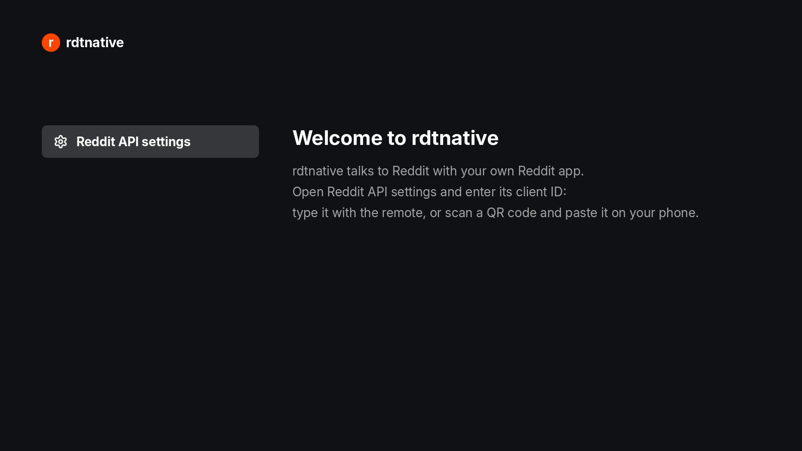
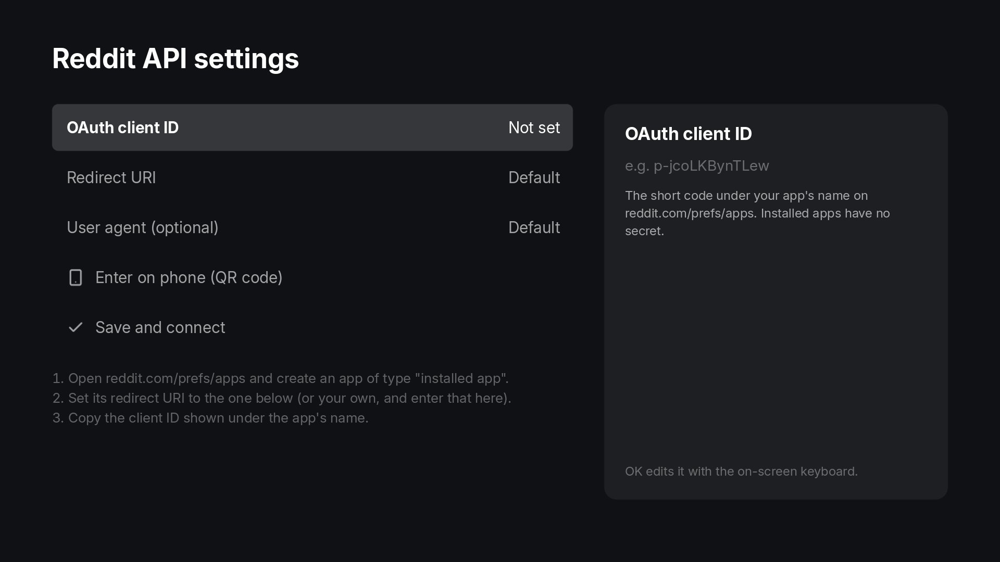
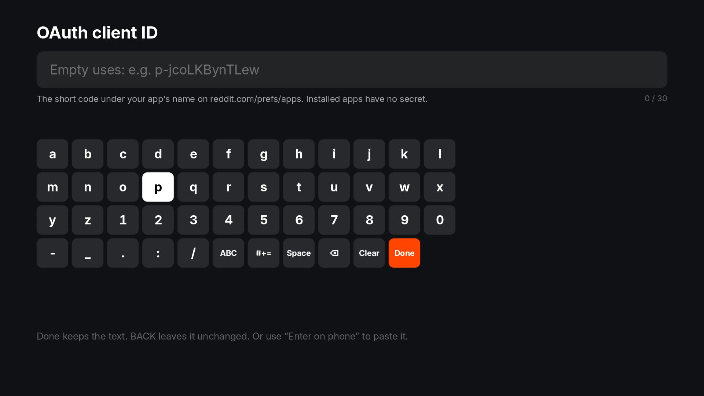
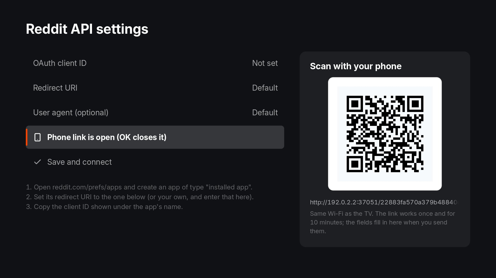

# rdtnative

A native Reddit client for LG webOS TVs (webOS 4+), built for the Magic Remote. It is a Rust app
with no browser or Android runtime, built the same way as
[ytnative](https://github.com/danzig666/ytnative): the UI core is vendored from
[plx-native](https://github.com/GLinnik21/plx-native) and draws with OpenGL ES.

Every user connects rdtnative to **their own Reddit app** (an "installed app" client ID). The
client ID, redirect URI and user agent are typed with the remote, or entered on a phone by
scanning a QR code (a one-time page on the home network).

> Not affiliated with Reddit or LG. Use at your own risk.

**Status:** Phase 1 (app shell). Settings › Reddit API works, and the front page loads as a list
once a client ID is saved. Cards, media, comments and sign-in come next; see [PLAN.md](PLAN.md).

| | |
|---|---|
|  |  |
|  |  |

These are screenshots from the Linux simulator, which runs the same UI code as the TV build.

## Building

Requirements: Rust stable, `rustup target add armv7-unknown-linux-gnueabi`, and
`python -m pip install ziglang==0.13.0`.

```bash
cargo test                       # rd-core, rd-phone, rd-spike, xtask
cargo xtask build                # cross-build for the TV (+ DT_NEEDED check)
cargo xtask ipk                  # target/ipk/io.github.danzig666.rdtnative_<ver>_arm.ipk
cargo xtask install              # install on a rooted TV over SSH (see docs/debugging.md)
```

Or install the IPK with LG's CLI: `ares-install --device <tv> target/ipk/*.ipk`.

### Simulator

The app runs in a 1920x1080 window on a PC: Windows (run `tools/fetch-sim-deps.ps1` once), or
Linux with SDL2, SDL2_ttf and libGL (`apt install libsdl2-dev libsdl2-ttf-dev libgl-dev`).

```bash
cargo xtask sim --detach         # build + start it
cargo xtask sim-key down ok      # press remote keys
cargo xtask sim-shot settings    # target/shots/settings.png
```

On a headless Linux machine, run it under `Xvfb :99` with `DISPLAY=:99`.

### Layout

- `crates/rd-core`: the Reddit API (OAuth, session, rate limits, posts, comment trees). Pure Rust.
- `crates/rd-phone`: the one-time "enter on phone" LAN form and QR code.
- `crates/rd-spike`: Phase 0 CLI for trying the API on a PC or the TV ([docs/phase0.md](docs/phase0.md)).
- `crates/app`: the TV app (plx UI core, SDL2, GLES2).
- `vendor/plx`, `xtask`, `ci`, `tools`: from ytnative.

## Credits and license

- [ytnative](https://github.com/danzig666/ytnative): the app shell, build system and TV integration.
- [plx-native](https://github.com/GLinnik21/plx-native) by Gleb Linnik and contributors: the
  vendored UI core (GPL-3.0).
- [ReSync](https://github.com/danzig666/ReSync): the feature reference (no code is copied).
- Fonts: Inter (OFL) and the other bundled fonts with their licences in `crates/app/pkg`.

rdtnative is licensed under the GNU GPL v3.0 (see [LICENSE](LICENSE)).
